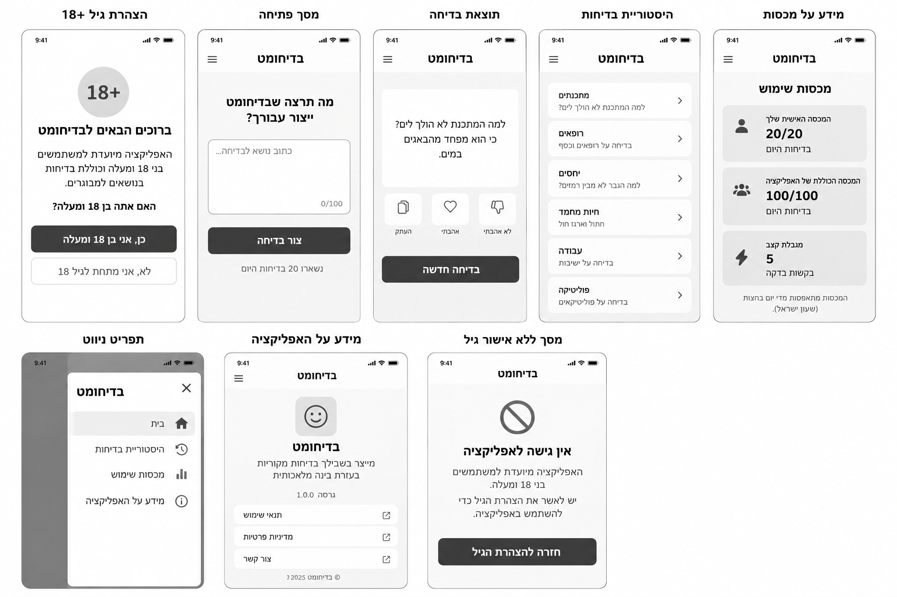
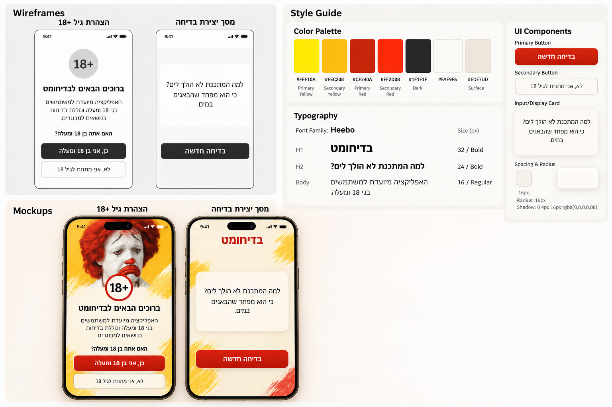
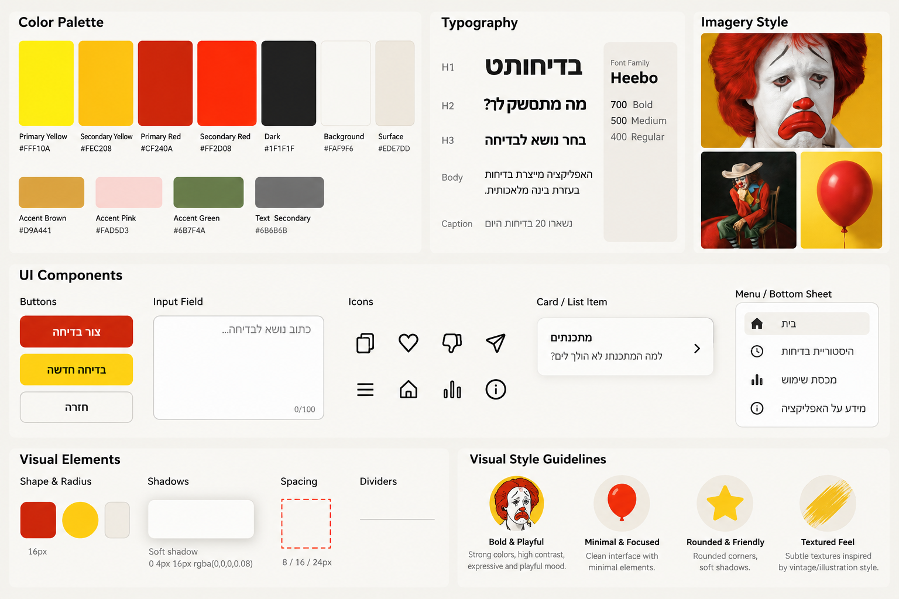

# DESIGN — בדיחומט

> מסמך אפיון עיצובי ל-MVP · שפת ממשק: עברית (RTL) · פלטפורמה: Mobile First PWA

## מקורות חזותיים וסדר קדימויות

- **PRD.md** הוא מקור האמת להיקף המוצר, התנהגות ופעולות מותרות.
- **Wireframes** הם ייחוס לפריסה ולהיררכיה, רק במקומות שאינם סותרים את ה-PRD.
- **Style Guide** הוא ייחוס לצבע, טיפוגרפיה, רכיבים ואווירה.
- **Mockups** הם ייחוס לגימור החזותי של הרכיבים המאושרים.

**הבהרת התאמה חשובה:** בלוחות ה-Wireframes וה-Mockups מופיעים שמונה ייצוגים, ובהם מסכי **היסטוריית בדיחות**, **מידע על מכסות**, **תפריט ניווט**, **מידע על האפליקציה**, וכן פעולות העתקה, לייק ודיסלייק. אלו **אינם חלק מה-MVP** לפי ה-PRD. אין לממשם רק משום שהם מופיעים בתמונות. גם רשימת נושאים/קטגוריות שבתמונה אינה דרישת מוצר. תמונת ה-Mockups משמשת השראה ויזואלית בלבד לרכיבים המאושרים. מסך Offline, שנדרש ב-PRD, אינו מוצג בלוחות; יש לממשו לפי ההנחיות המינימליות להלן, ללא המצאת עיצוב ייחודי חדש.

## 1. Screens — מסכי האפליקציה

### 1.1 הצהרת גיל 18+

**מטרה:** קבלת אישור גיל לפני שימוש ראשון.

**מבנה ותוכן:** פריסת Smartphone אנכית; אזור עליון עם דימוי ליצן כאלמנט מותג חזותי בהשראת ה-Mockups; סימון `18+` גדול; כותרת קבלת פנים; טקסט הסבר קצר; שאלה מודגשת; שתי פעולות אנכיות וברורות. הפעולה הראשית היא כפתור אדום מלא; הפעולה המשנית היא כפתור בהיר עם קו מתאר.

**פעולות וניווט:** `כן, אני בן 18 ומעלה` מוביל למסך הראשי. `לא, אני מתחת לגיל 18` מוביל למסך חסימת גישה. אין שדות הזדהות או אימות מסמכים.

### 1.2 מסך ראשי — פתיחה ויצירת בדיחה

**מטרה:** לאפשר הזנת נושא ויצירת בדיחה אחת במהירות.

**מבנה ותוכן:** כותרת מותג `בדיחומט` באזור העליון; מתחתיה כותרת פתיחה `על מה צוחקים היום? 😂` והנחיה קצרה על האפשרות להשאיר נושא ריק. תיבת טקסט גדולה ומעוגלת עם Placeholder בעברית, ומגבלת 100 תווים. מתחתיה כפתור Primary בולט `צור בדיחה` ושורת יתרה יומית, למשל `נשארו 20 בדיחות היום`. יישור השדה, התוכן והטקסט מותאם ל-RTL. אין תפריט Hamburger ב-MVP.

**פעולות וניווט:** הקלדת נושא או השארת שדה ריק; לחיצה על `צור בדיחה` או Enter; מעבר בתוך אותו מסך לתצוגת בדיחה. אין מעבר למסך היסטוריה או למסך מכסות נפרד.

### 1.3 תצוגת בדיחה — מצב תוכן של המסך הראשי

**מטרה:** להציג את הבדיחה שנוצרה ולאפשר בקשה נוספת.

**מבנה ותוכן:** אין זה Route נפרד אלא **מצב של המסך הראשי**. יש לשמר את שדה הנושא ואת הפעולה הראשית בממשק; להציג בדיחה אחת בתוך כרטיס בהיר, גדול וקריא, ללא כותרת נושא. כפתור יצירה חוזרת משתמש באותו נושא, כאשר ניתן לשנותו. הדגשת הטקסט באמצעות ניגודיות גבוהה, ריווח נדיב ופינות מעוגלות, בהתאם לכרטיס התוצאה שב-Mockups.

**פעולות וניווט:** יצירה נוספת מחליפה את הבדיחה המוצגת רק לאחר הצלחה; הבדיחה הישנה נשארת במהלך טעינה או שגיאה. **אין** כפתורי העתקה, לייק או דיסלייק המופיעים בתמונת ההמחשה.

### 1.4 מסך ללא אישור גיל

**מטרה:** למנוע שימוש ללא אישור גיל ולספק דרך חזרה להצהרה.

**מבנה ותוכן:** כותרת מותג; סמל חסימה בולט בצבע אדום; כותרת `אין גישה לאפליקציה`; טקסט קצר המבהיר שהאפליקציה מיועדת לבני 18 ומעלה; כפתור Primary רחב `חזרה להצהרת הגיל`. מבנה אנכי ממורכז, כפי שמופיע בלוחות.

**פעולות וניווט:** חזרה למסך הצהרת הגיל בלבד; ללא גישה ליצירת בדיחות.

### 1.5 מסך Offline

**מטרה:** להבהיר שאין חיבור ולספק ניסיון חוזר.

**מבנה ותוכן:** מסך עצמאי עם אותו רקע בהיר, טיפוגרפיה, פינות וריווח של יתר המוצר; ההודעה `אין חיבור לאינטרנט. בדוק את החיבור ונסה שוב.` וכפתור Primary `נסה שוב`. אין להוסיף תמונות, ניווט או פעולות שלא נדרשו.

**פעולות וניווט:** ניסיון חוזר לבדיקת החיבור; כאשר החיבור חוזר, חזרה לזרימת השימוש הרגילה בהתאם לאישור הגיל השמור.

### 1.6 מצבים בתוך המסך הראשי — לא מסכים נוספים

- **Loading:** אנימציה עדינה והטקסט `ממציאים לך בדיחה...`; שדה הנושא וכפתור היצירה מושבתים; בדיחה קיימת נשארת גלויה.
- **קלט לא תקין:** הודעה צמודה לשדה, `רווחים זה נחמד, אבל תן לנו נושא אמיתי 😅`.
- **כשל או Timeout:** הודעה ידידותית סמוך לאזור התוצאה, ללא הסתרת בדיחה קיימת; ניסיון חוזר באמצעות פעולת היצירה הרגילה.
- **סירוב תוכן:** הודעה הומוריסטית המבקשת נושא אחר, ללא יצירת בדיחה חלופית.
- **Rate Limiting:** הודעת `רגע, גם לקומיקאי מגיע לנשום 😅`, Countdown והשבתת כפתור היצירה למשך ההמתנה.
- **מכסה אישית או כללית מוצתה:** הודעת המכסה המוגדרת ב-PRD במקום הפעולה הזמינה, וכפתור יצירה מושבת.

כל המצבים משתמשים באותה מערכת רכיבים; אין לתכנן עבורם מסכים חדשים או לשנות את מיקומי האלמנטים המרכזיים.

### 1.7 מבנה הניווט הכללי

הניווט מינימלי: **הצהרת גיל → מסך ראשי**, או **הצהרת גיל → חסימת גישה → הצהרת גיל**. תוצאת בדיחה ומצבי טעינה/שגיאה מוצגים בתוך המסך הראשי. מסך Offline מופיע רק כשאין חיבור. אין Bottom Navigation, Drawer, Tabs, היסטוריה או מסך Settings ב-MVP.

## 2. Style Guide — השפה העיצובית

### 2.1 Color Palette

הצבעים להלן מועתקים מקודי ה-HEX המוצגים ב-Style Guide; השילוב נשען על צהוב ואדום רוויים המזכירים מיתוג רטרו של קומדיה וליצנות, עם רקעים חמים וניטרליים.

| Token / שימוש | HEX | תפקיד |
|---|---|---|
| `primary-yellow` | `#FFF10A` | הדגשות שמחות, משטחים ואיורים |
| `secondary-yellow` | `#FEC208` | כפתור חלופי/הדגשה משנית |
| `primary-red` | `#CF240A` | מיתוג, פעולה ראשית והדגשה |
| `secondary-red` | `#FF2D08` | נגיעות גרפיות חמות |
| `dark` | `#1F1F1F` | טקסט ראשי ואייקונים |
| `background` | `#FAF9F6` | רקע עמוד בהיר וחמים |
| `surface` | `#EDE7DD` | רקעי משטח וכרטיסים משניים |
| `accent-brown` | `#D9A441` | גוון משלים חם; שימוש מצומצם |
| `accent-pink` | `#FAD5D3` | גוון משלים; שימוש מצומצם |
| `accent-green` | `#6B7F4A` | גוון משלים; אינו מחליף צבעי פעולה |
| `text-secondary` | `#6B6B6B` | טקסט עזר, מונה ו-Placeholder |

הצבעים המרכזיים בפועל הם **אדום, צהוב, קרם ושחור**. אין צורך להשתמש בכל גווני ה-Accent במסך אחד. כפתור Primary אדום עם טקסט לבן; כפתור Secondary בהיר עם טקסט כהה וקו מתאר. שמור על ניגודיות טקסט מספקת, במיוחד על צהוב.

### 2.2 Typography

- **Font Family:** `Heebo`, עם Fallback לגופן Sans-serif תומך עברית.
- **Weights:** `700 Bold` לכותרות ופעולות מרכזיות; `500 Medium` לכותרות משנה, כפתורים ותוויות; `400 Regular` לטקסט גוף.
- **H1 / כותרת מותג:** מומלץ `32px`, Bold.
- **H2 / כותרת מסך:** מומלץ `24px`, Bold.
- **H3 / כותרת משנה:** מומלץ `20px`, Bold או Medium לפי ההקשר.
- **Body / בדיחה וטקסט רגיל:** מומלץ `16px`, Regular; בדיחה יכולה לקבל משקל Medium להבלטה.
- **Caption / מונה וטקסט עזר:** מומלץ `14px`, Regular.

ה-Style Guide מציג היררכיית H1/H2/H3/Body/Caption ומשקלים אך אינו מגדיר מספרי px לכל דרגה; **הגדלים שלעיל הם ערכי מימוש מומלצים**, ולא נתונים מדודים מהתמונה. אין להשתמש בפונט תצוגה נוסף שאינו נדרש.

### 2.3 UI Style

**Buttons:** מלבנים מעוגלים ברדיוס `16px`, עם שטח לחיצה נדיב; Primary באדום מלא, טקסט לבן מודגש; Secondary בצהוב או ברקע בהיר בהתאם להקשר; פעולות משניות עם Border דק. מצבי Disabled נבדלים גם באמצעות ניגודיות/Opacity ולא רק צבע.

**Input Field:** תיבת טקסט גדולה ובהירה, Border אפור עדין, פינות `16px`, Placeholder אפור ויישור RTL; מונה תווים קטן בצד התחתון של השדה. אין להוסיף Dropdown של נושאים או הצעות אוטומטיות.

**Cards:** משטחים בגוון קרם/לבן עם פינות מעוגלות, הפרדה עדינה מהרקע וצל רך. כרטיס בדיחה מדגיש את התוכן ומונע עומס ויזואלי. כרטיסי רשימות ב-Style Guide הם ייחוס לסגנון בלבד; אין רשימות במוצר המאושר.

**Icons:** קווי מתאר פשוטים, עובי קו עקבי, צורות קריאות בגודל קטן; שימוש נקודתי בסמלי גיל, חסימה, טעינה או מצב חיבור. אייקוני לייק, העתקה, היסטוריה וניווט שמופיעים בהמחשות אינם חלק מה-MVP.

**Navigation:** ללא תפריט Hamburger או Bottom Sheet ב-MVP. אין לממש את רכיב ה-Menu שב-Style Guide אלא אם היקף המוצר ישתנה בעתיד.

### 2.4 Visual Style

- **אווירה:** משחקית, קומית, מעט נוסטלגית, עם השראה מדימויי ליצן עצוב מול צבעוניות נועזת. הניגוד בין הבעה רצינית לצבעים שמחים הוא חלק מהשפה החזותית.
- **Imagery:** דיוקן ליצן אדום-שיער, בלון אדום ודימוי ליצן ישוב הם רפרנסים חזותיים מה-Style Guide. שימוש בתמונות מותנה בזכויות שימוש ובקיום נכסים מתאימים; אין להניח שתמונות ה-Inspiration Board עצמן מורשות לשימוש במוצר.
- **Shapes:** פינות מעוגלות, עיגולים/תגים עבור הדגשות, מלבנים נקיים לכרטיסים.
- **Radius:** `16px` כרדיוס טיפוסי לכפתורים, שדות וכרטיסים; אלמנטים עגולים במקומות שהדימוי דורש זאת.
- **Spacing:** מדרגות בסיסיות של `8px`, `16px`, `24px` לפי ה-Style Guide; להקפיד על מרווח גדול בין אזורי תוכן מרכזיים.
- **Shadows:** צל רך `0 4px 16px rgba(0,0,0,0.08)` לפי ההמחשה, בעיקר לכרטיסים; להימנע מצללים כבדים.
- **Borders / Dividers:** קו דק ואפור בהיר, בשימוש מינימלי. ההיררכיה נשענת בעיקר על מרווח, צבע וגודל.
- **Texture:** רקע קרם עם טקסטורת נייר עדינה ומשיכות מכחול צהובות/אדומות, כפי שמופיע ב-Mockups; דקורציה לא תתחרה בקריאות השדה או הבדיחה.
- **Layout:** עמודת תוכן אחת בגובה Smartphone, מרכוז אופקי של הכותרת והפעולה הראשית, שדה ותוכן ברוחב נוח עם שוליים עקביים. גלילה אנכית טבעית במקרה של תוכן ארוך; אין להאריך מסגרת באופן מלאכותי.
- **Motion:** אנימציות עדינות בלבד, בעיקר בזמן יצירת בדיחה; להימנע מהסחות דעת ולכבד הגדרת `prefers-reduced-motion`.

### 2.5 שפה, RTL ונגישות בסיסית

- כל הטקסטים והפעולות המוצגים למשתמש הם **בעברית**; כיוון הממשק `dir="rtl"`.
- תוכן שדות, טקסט בדיחה והודעות מיושרים בהתאם לעברית; טקסטים מספריים וקודי HEX נשמרים בכיוון קריא, בלי לשבור את הסדר החזותי.
- לוגו וכותרות יכולים להיות ממורכזים; תוכן קריא וארוך צריך להישאר מיושר לימין.
- יש לשמור על Focus נראה לעין, על תוויות נגישות לכפתורים ועל ניגודיות מספקת; אין להסתמך על צבע בלבד כדי להעביר מצב.

## עקרון מימוש מסכם

לממש את **המבנה הפונקציונלי המצומצם של ה-PRD** עם **השפה החזותית של ה-Style Guide וה-Mockups**. אין להעתיק באופן אוטומטי מההמחשות מסכים, אייקונים אינטראקטיביים או פעולות שלא אושרו. רכיבי ה-UI המאושרים צריכים להרגיש כחלק מאותה משפחה: רקע קרם, אדום וצהוב דומיננטיים, Heebo, רדיוס 16px, צללים רכים וטון קומי ברור.
